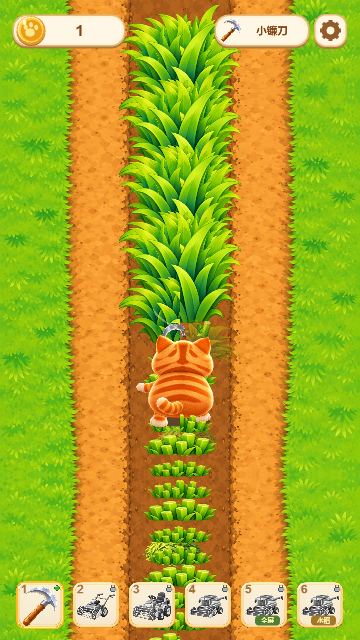
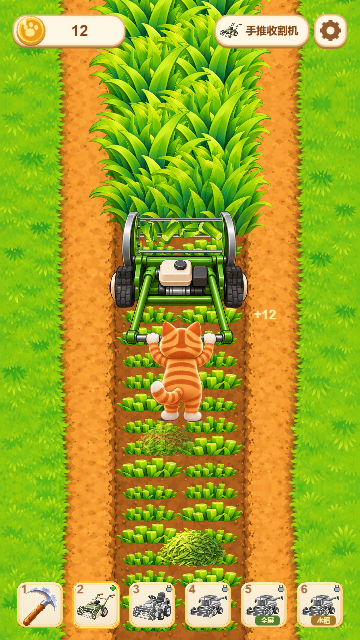
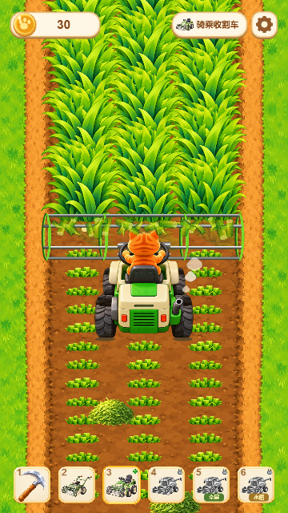
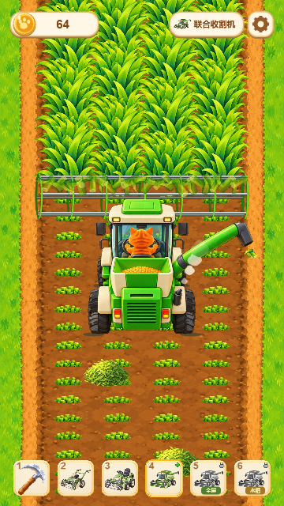
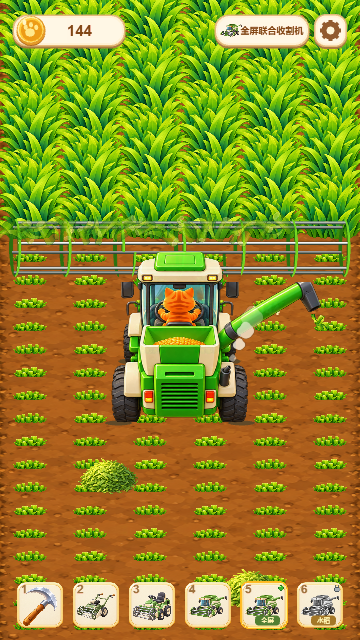
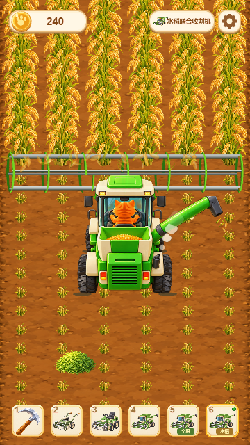
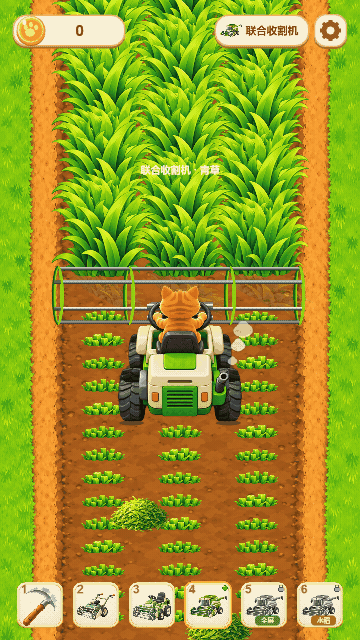

# 橘猫割草 2D

Cocos Creator **3.8.8** 竖屏 2D 自动收割游戏。设计分辨率 720 × 1280，支持 Web Mobile 和微信小游戏构建。

点击开始后自动收割、换垄和进入下一轮；金币足够时，点击角色头顶的道具气泡升级。正常界面没有暂停按钮，打开设置继续收割，切回前台自动继续。进度保存在本地，不计算离线收益。

## 游戏预览

以下为当前版本的实际运行画面，从手动挥镰刀逐步升级到全屏收割水稻。

| ① 小镰刀 | ② 手推收割机 | ③ 骑乘收割车 |
| :---: | :---: | :---: |
|  |  |  |

| ④ 联合收割机 | ⑤ 全屏联合收割机 | ⑥ 水稻联合收割机 |
| :---: | :---: | :---: |
|  |  |  |

### 升级动效

三级骑乘收割车升级为四级联合收割机的实际过程：



## 运行

1. 用 Cocos Creator 3.8.8 打开项目，等待资源导入。
2. 打开 `assets/scenes/Main.scene`，使用编辑器预览。
3. 点击“开始割草”。`ReferenceLayoutLab.scene` 是独立的首页预览入口。

六级依次为：小镰刀、手推收割机、骑乘收割车、联合收割机、全屏联合收割机、水稻联合收割机。第五、六级保持第四级车身大小，仅加宽收割滚筒。

## 目录

| 路径 | 内容 |
| --- | --- |
| `assets/scenes/` | 主场景与独立素材、动作样机 |
| `assets/scripts/` | 玩法、角色、地面、界面、音频、存档 |
| `assets/resources/` | 运行资源及历史样机依赖，保留对应 `.meta` |
| `settings/`、`.creator/` | Cocos 工程配置 |
| `tests/` | 不依赖浏览器的玩法、几何与素材检查 |
| `tools/` | 构建、资源整理、浏览器验证、性能检查 |
| `docs/素材整理/` | 已使用、主游戏未使用素材和来源清单 |
| `docs/` 中各素材包 | 原始素材及说明，用于追溯与重建图集 |

`build/`、`library/`、`temp/`、`profiles/`、`docs/verification/` 为本地产物，不提交到 Git。

## 主要代码

| 文件 | 职责 |
| --- | --- |
| `Config.ts`、`HarvestModel.ts` | 六级数值、收割、逐列结算、升级和状态流转 |
| `HarvestGame.ts`、`HomeUI.ts` | 游戏编排、生命周期、设置和升级界面 |
| `Actor.ts` 及各 `*HarvesterActor.ts` | 角色与机器动画；一级使用 `SickleWalkActor.ts` |
| `Field.ts`、`GrassSkin.ts`、`Haystacks.ts` | 地面、作物、倒伏、草碎、喷口出料、稀疏草垛 |
| `UpgradeFX.ts`、`Sound.ts` | 升级特效、背景音乐和音效设置；割草音效已取消 |
| `SaveStore.ts` | 本地存档、旧版迁移和损坏存档备份 |

角色使用完整原帧和固定接地锚点。水稻资源合并为图集，减少绘制提交；粒子与草垛复用节点。草垛每五排一垛，位置和大小略有变化。

历史方案见 [历史实现记录](docs/历史实现记录.md)，其中部分描述旧版行为，当前行为以代码及本文为准。

## 检查与构建

需要 Node.js、Python 3（资源脚本使用 Pillow）和 Cocos Creator 3.8.8。在工程根目录 PowerShell 中运行：

```powershell
./tools/verify.ps1
./tools/build.ps1 -Platform web-mobile
node tools/serve.cjs
# 浏览器打开 http://127.0.0.1:8092
./tools/build.ps1 -Platform wechatgame -Release
```

编辑器不在默认路径时，给两个 PowerShell 脚本传入 `-CreatorRoot`。脚本使用编辑器自带的 TypeScript。Cocos 构建退出码 36 表示成功。微信配置中的 `touristappid` 是测试值，发布前替换为自己的 AppID。

浏览器验证依赖 Playwright。环境配置、当前检查入口和历史脚本说明见 [tools/README.md](tools/README.md)。

```powershell
python tools/pack-rice-atlas.py --check
python tools/organize-assets.py
```

素材整理只更新清单和分类副本，不移动或删除原始素材。

## 调试与搞笑录屏

开发构建提供 DEV 面板、动作检查及逐帧工具；Release 构建关闭这些入口和测试全局对象。

访问 `/?funny=1` 可进入一级斜走挥刀的独立录屏模式，也可在设置里切换。该模式使用临时进度，不覆盖正常存档；关闭后恢复原进度。

## 联系作者

欢迎交流游戏开发与项目使用问题，微信扫码添加作者：


